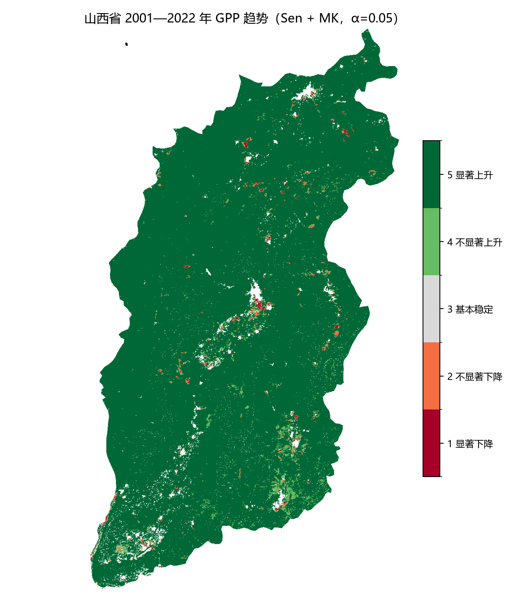
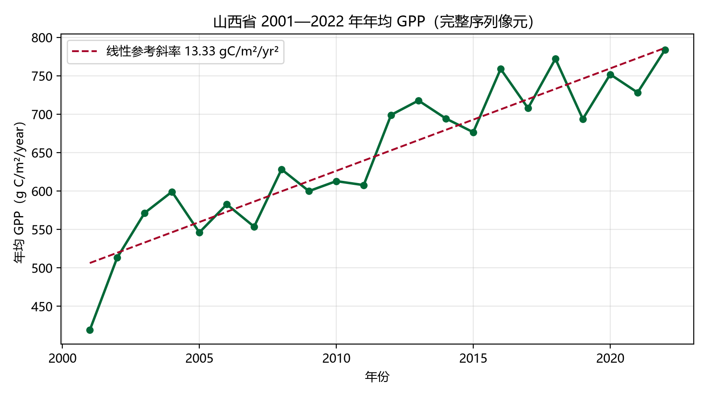

# GEE 长时序栅格趋势分析：Sen's slope + Mann–Kendall 方法全记录

> 复刻并扩展自微信公众号「遥感智研」的教程
> [《GEE 实战｜Sen's slope + Mann–Kendall：长时间序列栅格趋势分析》](https://mp.weixin.qq.com/s/c6bo6jAJOXrIuu6iedlvLA)。
> 原版：黄土高原 2001—2024 年 MODIS NDVI。
> 本仓库：完整方法拆解 + 可运行代码 + **山西省 2001—2022 年 GPP** 落地案例。

**这个仓库把一套 Sen + MK 趋势分析从“能跑”拆到“能解释、能复现、能答辩”。**
包括公式、年度指标口径、GEE 实现细节、ties 修正、五级分级、面积统计，
以及复刻过程中真实踩过的坑。

---

## 1. 方法解决什么问题

遥感长时序里，“第一年低、最后一年高”不等于存在稳定趋势。年际波动、云污染、
极端年份都会让首尾差值误判。Sen + MK 用两个互补的部分回答：

| 问题 | 方法 | 输出 |
|---|---|---|
| 平均每年变化多少？ | Sen's slope（Theil–Sen） | 斜率 β，带单位 |
| 这个变化是否显著？ | Mann–Kendall 检验 | Z、双侧 p |

二者都不要求正态分布，且对异常值稳健，因此广泛用于 NDVI、GPP、NPP、
降水、土壤水分、LST 等长时序栅格。

```text
原始遥感产品
  → QA 掩膜
  → 年度指标（状态量取峰值/均值，通量取累加）
  → 完整序列掩膜（n 年全有效）
  → Sen 斜率（全部年份对斜率的中位数）
  → MK S → ties 修正方差 → Z → p
  → 五级分类（方向 × 显著性）
  → 面积统计 / 制图 / 年际曲线
```

核心公式：

$$
\beta=\mathrm{median}\left\lbrace\frac{x_j-x_i}{j-i}\right\rbrace
$$

$$
S=\sum_{i<j}\mathrm{sgn}(x_j-x_i),\qquad
\mathrm{Var}(S)=\frac{n(n-1)(2n+5)-\sum_p t_p(t_p-1)(2t_p+5)}{18}
$$

$$
Z=\frac{S\mp1}{\sqrt{\mathrm{Var}(S)}},\qquad
p=2\left(1-\Phi(|Z|)\right)
$$

α = 0.05 时，|Z| ≥ 1.96 为显著。

## 2. 五级趋势分类

| 编码 | 类型 | 条件 | 配色 |
|---:|---|---|---|
| 1 | 显著下降 | Slope < 0，p < 0.05 | `#A50026` |
| 2 | 不显著下降 | Slope < 0，p ≥ 0.05 | `#F46D43` |
| 3 | 基本稳定 | Slope = 0 | `#D9D9D9` |
| 4 | 不显著上升 | Slope > 0，p ≥ 0.05 | `#66BD63` |
| 5 | 显著上升 | Slope > 0，p < 0.05 | `#006837` |

“稳定”判据是斜率精确为 0，对连续变量几乎为空，属预期行为；
需要非零稳定区时显式设置容差（见 [docs/03](docs/03-trend-classification.md)）。

## 3. 仓库内容

| 路径 | 内容 |
|---|---|
| [`docs/00-method-map.md`](docs/00-method-map.md) | 原文方法逐项对照 + 本仓库扩展/差异 |
| [`docs/01-sen-slope.md`](docs/01-sen-slope.md) | Sen 斜率原理、配对数量、单位、GEE 写法 |
| [`docs/02-mann-kendall.md`](docs/02-mann-kendall.md) | S、ties 修正、连续性修正、Z/p、自相关局限 |
| [`docs/03-trend-classification.md`](docs/03-trend-classification.md) | 五级规则、制图、面积统计、解读底线 |
| [`docs/04-annual-metric.md`](docs/04-annual-metric.md) | 年度指标：NDVI 取最大 vs GPP 取累加 |
| [`docs/05-gee-implementation.md`](docs/05-gee-implementation.md) | GEE 全流程实现、投影/掩膜/容量/导出 |
| [`docs/06-local-python.md`](docs/06-local-python.md) | 本地 numpy 实现、分块、面积、性能 |
| [`docs/07-pitfalls.md`](docs/07-pitfalls.md) | 现象→根因→解决的完整踩坑复盘 |
| [`docs/08-case-shanxi-gpp.md`](docs/08-case-shanxi-gpp.md) | 山西 GPP 案例：数据、结果、解读、局限 |
| [`docs/09-faq.md`](docs/09-faq.md) | 15 个常见问题 |
| [`code/gee/sen_mk_ndvi.js`](code/gee/sen_mk_ndvi.js) | 完整 NDVI 示例（MOD13A1，2001—2024） |
| [`code/gee/gpp_shanxi/`](code/gee/gpp_shanxi/) | GPP 案例分阶段脚本（01—05，实跑通过） |
| [`code/python/sen_mk_core.py`](code/python/sen_mk_core.py) | Sen/MK/分类核心算法（纯 numpy） |
| [`code/python/sen_mk_local.py`](code/python/sen_mk_local.py) | 通用本地分析脚本（栅格→结果→图） |
| [`tests/test_algorithms.py`](tests/test_algorithms.py) | 6 项数值自测 |
| [`results/`](results/) | 山西案例的结果图与统计表 |
| [`data/shanxi.geojson`](data/shanxi.geojson) | 2023 版山西省界（出图叠加用） |

## 4. 快速开始

### 4.1 只读方法

按 01 → 02 → 03 → 04 → 05 → 06 的顺序读；每篇都可独立看懂。
时间紧的话，先读 [docs/08](docs/08-case-shanxi-gpp.md) 的结果与局限。

### 4.2 GEE NDVI 示例

1. 打开 [GEE Code Editor](https://code.earthengine.google.com/)；
2. 粘贴 [`code/gee/sen_mk_ndvi.js`](code/gee/sen_mk_ndvi.js)；
3. 把 `ROI_ASSET` 换成你的矢量资产（或设为 `null`，用 GAUL 省级行政区）；
4. Run，查看五级图和面积表；
5. 需要导出时把 `EXPORT_RESULTS` 改为 `true`。

> 大区域若报 `Earth Engine capacity exceeded`，按
> [docs/05](docs/05-gee-implementation.md) 第 8 节拆阶段。

### 4.3 本地 Python

```bash
pip install numpy scipy rasterio matplotlib
# 可选：叠加边界
pip install geopandas

python tests/test_algorithms.py

python code/python/sen_mk_local.py \
  --data-dir "data/annual" \
  --pattern "GPP_raw_annual_{year}.tif" \
  --start-year 2001 --end-year 2022 \
  --scale 0.1 \
  --boundary "data/shanxi.geojson" \
  --out results
```

输入要求：每年一个同网格栅格，文件名含年份，nodata 表示缺测（不要补 0）。

### 4.4 山西 GPP 案例

数据不随仓库分发。按 [`docs/08`](docs/08-case-shanxi-gpp.md) 的复现步骤，
先用 `code/gee/gpp_shanxi/` 取数，再跑本地脚本。案例结果：



| 指标 | 数值 |
|---|---|
| 有效分析面积 | 151,728.7 km²（全省 96.8%） |
| 年均 GPP | 419.1（2001）→ 783.8（2022）g C/m²/year |
| Sen 斜率中位数 | 13.46 g C/m²/yr²（p2=2.95，p98=22.91） |
| 显著上升 | 96.58%（146,539.6 km²） |
| 不显著上升 | 2.48%（3,768.0 km²） |
| 显著下降 | 0.27%（405.2 km²） |
| 不显著下降 | 0.67%（1,011.2 km²） |
| 基本稳定 | 0.003%（4.7 km²） |



## 5. 关键结论与边界

1. **Sen 给幅度，MK 给显著性，不能互相替代。**
2. **年度指标必须先判断变量语义**：状态量取峰值/均值，通量取累加。
   把 GPP 按 NDVI 取最大是口径错误。
3. **缺测不能补 0**：补 0 会制造虚假下降。本仓库采用完整序列掩膜。
4. **MK 假设序列独立**：未做自相关修正时，显著性可能偏高；
   正式论文应说明，或用 Hamed–Rao / 预白化复核。
5. **GPP 上升 ≠ 碳汇上升**：GPP 是总光合固碳，净碳汇需扣呼吸。
6. **趋势 ≠ 因果**：Sen + MK 只描述单调性，驱动机制需另做归因。
7. **“基本稳定”几乎为空是正常的**：判据是斜率精确为 0。

## 6. 算法自测

```bash
python tests/test_algorithms.py
```

覆盖：

- ties 修正与教科书公式逐例一致（含真实 0 值）；
- Sen 斜率与显式配对中位数一致；
- S 与暴力双重循环一致；
- |Z| = 1.96 → p = 0.05；
- 五级分类边界；
- 常量序列 → Z=0、p=1、类 3。

## 7. 与指纹仓库的关系

GPP 批量下载时 `getDownloadURL` 会忽略文件名，得到哈希名文件。
本仓库用“多点像元指纹”认领年份，方法已独立开源：
[`mengzhuoer/yaogan-zhiwen`](https://github.com/mengzhuoer/yaogan-zhiwen)。

## 8. 参考文献

- Sen, P. K. (1968). Estimates of the regression coefficient based on Kendall's tau.
  *Journal of the American Statistical Association*, 63(324), 1379–1389.
- Theil, H. (1950). A rank-invariant method of linear and polynomial regression analysis.
- Mann, H. B. (1945). Nonparametric tests against trend. *Econometrica*, 13(3), 245–259.
- Kendall, M. G. (1975). *Rank Correlation Methods*. Charles Griffin.
- Hamed, K. H., & Rao, A. R. (1998). A modified Mann-Kendall trend test for
  autocorrelated data. *Journal of Hydrology*, 204(1–4), 182–196.
- Gocic, M., & Trajkovic, S. (2013). Analysis of changes in meteorological variables
  using Sen's slope and Mann-Kendall test in Serbia. *Global and Planetary Change*,
  100, 172–184.
- Running, S. W., et al. MOD17A2HGF: MODIS/Terra Gross Primary Productivity
  8-Day L4 Global 500 m SIN Grid V061. NASA EOSDIS Land Processes DAAC.
- Gorelick, N., et al. (2017). Google Earth Engine: Planetary-scale geospatial analysis
  for everyone. *Remote Sensing of Environment*, 202, 18–27.

## 9. 许可与致谢

- 代码：MIT，见 [LICENSE](LICENSE)。
- 方法来源：微信公众号「遥感智研」的公开教程；本仓库为独立复刻与方法整理，
  不转载原文，原教程版权归原作者所有。
- 案例数据：NASA MODIS 产品，经 Google Earth Engine 获取。
- 边界：2023 版中国行政区划数据（省级码 140000）。

如果这套整理对你有帮助，欢迎在 Issues 里补充你遇到的坑或改进建议。
