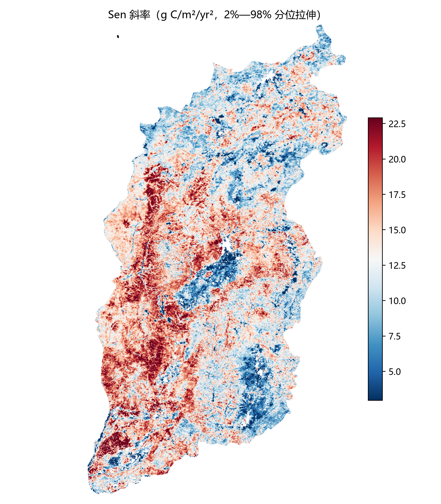

# 08 · 案例：山西省 2001—2022 年 GPP 趋势

## 1. 任务来源

导师要求：把「遥感智研」公众号 Sen + MK 教程中的 **NDVI 换成 GEE 上的 GPP 数据，
研究区换成山西省**，分析框架保持不变。

原教程：黄土高原，2001—2024，MODIS MOD13A1 NDVI，生长季最大值。
本案例：山西省，2001—2022，MODIS MOD17A2HGF GPP，全年累加。

## 2. 数据

| 项目 | 口径 |
|---|---|
| 产品 | `MODIS/061/MOD17A2HGF`，500 m，8 天，gap-filled 累计 GPP |
| 波段 | `Gpp`（`PsnNet`、`Psn_QC` 未使用） |
| 有效值 | 原始整数 ∈ [0, 3000]，保留产品掩膜；缺测不补 0 |
| 年度指标 | 每年 46 个时段齐全且像元全时段有效 → 全年累加 |
| 物理值 | 原始整数 × 0.1 = g C/m²/year |
| 年份 | 2001—2022，共 22 年 |
| 研究区 | GAUL/2015 省级行政区，太原坐标空间选取（实际名 `Shanxi Sheng`） |
| 边界叠加 | 2023 版山西省界（`data/shanxi.geojson`，面积 156,704 km²） |
| 下载网格 | EPSG:4326，961×1380，像元 0.0044915764°，nodata = -2147483648 |

## 3. 流程

```text
[1] GEE 检查      边界、影像数、每年时段数、波段             01_check_annual_gpp.js
[2] GEE 取数      8 天 GPP 逐年累加 → 导出资产/下载链接      02_export... / 03_download...
[3] 身份核验      8 点指纹认领哈希文件年份 → 22 年核对       04_fingerprint... / 05_fill...
[4] 本地计算      22 年堆栈 → Sen/MK → 栅格/统计/图          06_local_trend.py
```

第 4 步即本仓库的 `code/python/sen_mk_local.py`，已重构为通用脚本并用本案复算，
结果与原始项目逐位一致。

## 4. 结果

### 4.1 年际变化


- 2001 年省域年均 419.1 → 2022 年 783.8 g C/m²/year，增幅约 87%；
- 2012、2018、2022 为较高年份，2001、2005 较低；
- 年际波动明显，说明单看首尾差值容易误判，需要 MK 检验。

### 4.2 趋势幅度



- Sen 斜率中位数 **13.46 g C/m²/yr²**；
- p2 = 2.95，p25 = 10.65，p75 = 16.23，p98 = 22.91 g C/m²/yr²；
- 几乎全省为正，负值集中在少数区域。

### 4.3 五级分类


| 类别 | 面积 km² | 占有效面积 |
|---|---:|---:|
| 1 显著下降 | 405.2 | 0.27% |
| 2 不显著下降 | 1,011.2 | 0.67% |
| 3 基本稳定 | 4.7 | 0.003% |
| 4 不显著上升 | 3,768.0 | 2.48% |
| 5 显著上升 | 146,539.6 | 96.58% |
| **合计** | **151,728.7** | **100%** |

- 有效分析面积 151,728.7 km²，占山西省官方面积 156,704 km² 的 **96.8%**；
- 完整序列像元 767,787 / 1,326,180（57.9%，其余为省界外矩形角与缺测）；
- 显著像元（p < 0.05）占 96.9%。

## 5. 怎么解读

### 可以说的

- 2001—2022 年山西省 GPP 呈**广泛、显著上升**，中位速率约 13.5 g C/m²/yr²；
- 下降区域不足 1%，空间上零散，需结合矿区、城镇扩展、土地利用变化做专题解释；
- 上升幅度在空间上不均匀，吕梁、太行等区域差异可作为后续分区统计的切入点。

### 不能直接说的

1. **“山西碳汇增加了 87%”** —— GPP 是总光合固碳，净碳汇还要扣生态系统呼吸（NPP/Reco）。
2. **“所有上升都显著且真实”** —— MK 未做自相关修正，96.9% 可能被高估；
   应在论文中说明，或用 Hamed–Rao 修正复核。
3. **“显著上升就是生态改善”** —— 可能是降水增加、复种指数提高、退耕还林、
   灌溉扩张等共同作用，需要归因分析。
4. **“下降区就是退化”** —— 可能是矿区、城市扩张或数据边缘效应，需逐区核查。

## 6. 已知局限

| 局限 | 影响 | 后续 |
|---|---|---|
| 未做时间自相关修正 | 显著性可能偏高 | Hamed–Rao / 预白化 / 块 bootstrap |
| 统计用 GAUL 边界 | 与 2023 版省界有细微差异 | 用 2023 版 `shanxi.geojson` 裁剪重跑（网格不变） |
| 完整序列掩膜 | 覆盖率 96.8% | 报告覆盖率，不做插值补 0 |
| GPP 年累加 | 不含呼吸 | 若研究碳汇，改用 NPP 或 NEP |
| 单一产品 | 产品误差未评估 | 与 MOD17A3HGF 或 GOSIF 交叉验证 |

## 7. 复现

数据文件不随仓库分发（体积与版权原因）。复现步骤：

1. 在 GEE 跑 `code/gee/gpp_shanxi/01_check_annual_gpp.js`，确认边界与数据；
2. 跑 `02` / `03` 导出或生成下载链接，得到 22 个年度 GeoTIFF；
3. 若文件名是哈希，用 `04` / `05` 生成并比对指纹（详见 `yaogan-zhiwen`）；
4. 本地运行：

```bash
python code/python/sen_mk_local.py \
  --data-dir "D:/Zcode/GEE/导出" \
  --pattern "Shanxi_GAUL_GPP_raw_annual_{year}.tif" \
  --start-year 2001 --end-year 2022 \
  --scale 0.1 \
  --boundary "data/shanxi.geojson" \
  --out results
```

5. 对照 `results/trend_area_stats.csv` 与本文表格。

## 8. 从案例提炼的通用步骤

1. 明确变量语义（状态量/通量）→ 选年度指标；
2. 固定研究区、年份、产品、QA、比例因子；
3. GEE 分阶段取数与导出，统一网格；
4. 文件身份核验（指纹或 manifest）；
5. 本地或 GEE 计算 Sen + MK；
6. 五级分类 + 面积统计 + 年际曲线；
7. 明确局限，再解读。
